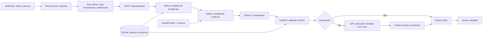

# Arquitetura da Central de Reembolsos

O backend concentra a lógica de raciocínio, recuperação de políticas e validação.
O endpoint POST `/casos/analisar` executa os três agentes sequencialmente em Python
puro com o SDK oficial `google-genai`, ou com fallback determinístico. O n8n apenas
integra a entrada, o Data Lake, a execução autorizada e a comunicação.

## Dados e rastreabilidade

O `case_id` UUID liga a entrada, os arquivos, os pareceres, a autorização e a
transação. A Bronze preserva o JSON original e os arquivos binários recebidos.
A Silver contém `caso` e referências aos IDs Bronze. A Gold contém decisão,
verificações, fontes, status de execução, IDs de arquivos e `transaction_id`
quando confirmado. O workflow valida o recibo relendo o histórico oficial.

As tabelas SQLite são `pedidos`, `reembolsos`, `casos` e `analises`. `casos` persiste
o envelope consolidado e a autorização no formato compatível com os endpoints
anteriores. `analises` armazena a entrada Silver e o resultado completo, com
metadados, para retornar o mesmo parecer em retentativas do mesmo UUID.
Ambos são salvos atomicamente. Dinheiro é `Decimal` nas regras
e centavos inteiros no SQLite. `pedido_id` e `case_id` são únicos em reembolsos;
o escopo admite apenas um estorno por pedido, inclusive se parcial.

As citações identificam documento, versão, seção, texto e hash. A ingestão
mantém as sete seções completas. Um catálogo carregado dos arquivos confere as
citações; os nomes não bastam para validar um trecho adulterado. Coleções são
identificadas pelo provedor/modelo e conteúdo para separar corpora e dimensões.

## Limite entre recomendação e autorização

Os agentes nunca executam pagamentos. POST `/casos/analisar` passa obrigatoriamente
pelo mesmo validador de POST `/validar`, que relê o pedido oficial e
confere recomendação, valor, estornos, identidade, citação, alçada, prazo,
compra online, data e pendências. Apenas arrependimento entre zero e sete dias
pode seguir automaticamente. Defeito e demais motivos vão para revisão humana,
sem deduzir perda de direito apenas pelo prazo desde a entrega.

O backend não confia em `vinculo_valido`, `elegivel_automatico`, dias ou valor
pago declarados pelos agentes: recalcula as condições críticas. Pelo menos um
identificador precisa ser informado; se CPF e ID forem enviados, ambos devem
conferir. Um snapshot oficial enviado pelo consumidor também deve conferir.

POST `/reembolsos/executar` exige autorização persistida para o mesmo UUID,
pedido e valor e verifica a validade temporal. Sob `BEGIN IMMEDIATE`, relê o
pedido, repete o validador e grava a operação. Duas execuções concorrentes para
o mesmo pedido não produzem dois estornos. A mesma operação concluída retorna
o mesmo recibo. O contador da falha 503 é confirmado antes de retornar o erro,
permitindo recuperação mesmo depois de reiniciar o processo.

## Modos e limites do protótipo

`USE_MOCK_LLM` controla os três agentes no backend. Com flag ativa ou sem chave,
o pipeline usa as funções determinísticas de `scripts/mock_agents.py`. No modo
real, cada etapa chama `client.models.generate_content` com `response_schema`
Pydantic, e a resposta é revalidada localmente. Erros de rede, bloqueio do provedor,
JSON inválido ou saída incompleta resultam em HTTP 502, sem autorização persistida.

`USE_MOCK_EMBEDDINGS` controla a vetorização separadamente. Se ela não for
definida, o modo segue `USE_MOCK_LLM`; sem chave, os embeddings também usam mock.
O n8n não precisa conhecer essas flags. Os prompts e seus schemas são exportados
para `docs/arquitetura_agentes.md` diretamente da fonte Python.

Cada análise inclui o modelo, o modo efetivo, o motivo do fallback, datas de
início/conclusão, duração total e hashes das entradas/saídas das seis etapas.
O hash de cada prompt permite identificar a instrução exata usada na análise.
Retentativas retornam a análise histórica salva, inclusive seu relógio original;
não renovam a validade da autorização. Para corrigir dados ou reanalisar com outro
modelo, gere novo `case_id`. A execução sempre revalida o estado financeiro atual.

A API é uma demonstração local sem autenticação e sem gateway financeiro real.
Conhecer CPF/ID cadastrado não autentica o solicitante. O sistema recebe campos
extraídos e status do comprovante; não faz OCR nem análise antifraude do binário.
A implantação pública precisaria autenticar integrações e clientes, proteger os
dados pessoais, definir retenção e integrar um provedor financeiro com seus
próprios controles de conciliação. Essas integrações não são simuladas como se
estivessem conectadas neste projeto.
